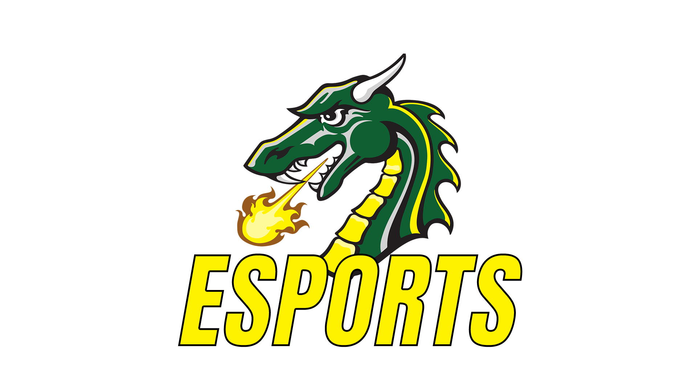
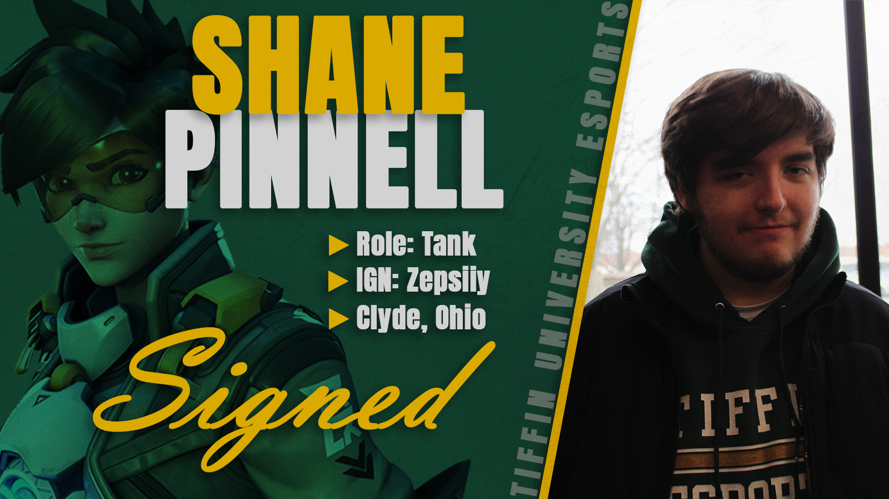
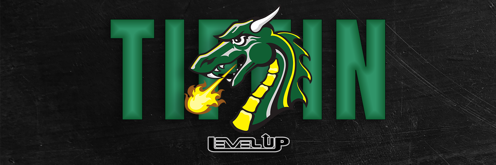
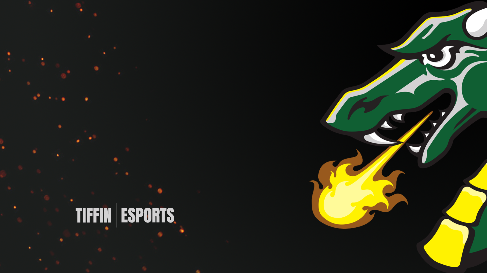
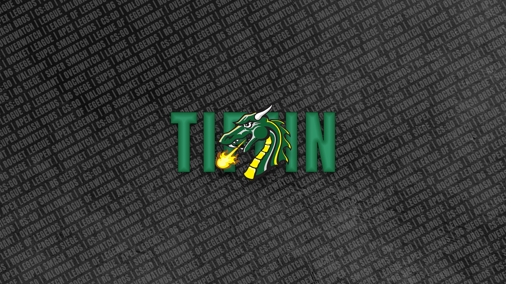

Some graphics that I designed and produced for Tiffin University's Esports program. This includes logo creation, profile pictures and banners for social media pages (Instagram, Twitter, YouTube, Twitch, etc.), and graphics to introduce newly signed players to the program.

<figure>
  
  <figcaption>Primary team logo.</figcaption>
</figure>

<figure>
  
  <figcaption>Graphic for announcing new player signings.</figcaption>
</figure>

<figure>
  
  <figcaption>Animated Discord server profile gif.</figcaption>
</figure>

<figure>
  
  <figcaption>Twitter banner with team sponsors.</figcaption>
</figure>

<figure>
  
  <figcaption>Desktop wallpaper concept.</figcaption>
</figure>

<figure>
  
  <figcaption>YouTube channel banner.</figcaption>
</figure>