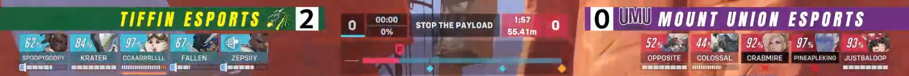

Some graphics that I designed and produced for Tiffin University's Esports program to use during their live broadcasts on Twitch.

### Stream overlays

<figure>
  
  <figcaption>Overwatch stream overlay used during broadcasts.</figcaption>
</figure>

### Stream panels and link graphics

<figure>
  
  <figcaption>Donation callout panel.</figcaption>
</figure>

<figure>
  
  <figcaption>Facebook social panel.</figcaption>
</figure>

<figure>
  
  <figcaption>Instagram social panel.</figcaption>
</figure>

<figure>
  
  <figcaption>Recruitment panel for attracting players.</figcaption>
</figure>

<figure>
  
  <figcaption>Twitter social panel.</figcaption>
</figure>

<figure>
  
  <figcaption>Website link panel.</figcaption>
</figure>

<figure>
  
  <figcaption>YouTube social panel.</figcaption>
</figure>