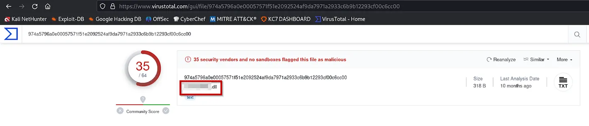

Hey there!

So, I've jumped into KC7's "Intro To Pivoting And Analysis" cyber security course, and I'm here to share my thoughts as I navigate through it. No fancy cybersecurity expert here - just me, trying to make sense of security log data analysis and get better at threat intelligence.

Pivoting is the name of the game, like tracing footprints through different datasets. I like to think of it as solving a puzzle or pretending to be Sherlock Holmes. What is the goal though? To unravel the moves of potential cyber threats, decode their tactics, spot those crafty patterns, and maybe even group similar tricks together.

The playground for this adventure is Azure Data Explorer (ADX), which might sound complex, but don't worry - we'll tackle it step by step. And to keep score, there's the KC7 scoreboard, guiding my progress and throwing some challenges my way.

Some things to note:

- I will not be including answers in this walkthrough. The guide is intended to help myself and others understand the thought process behind the questions.
- Everyone does queries different ways, which is why your queries may look a little different than mine.
- If you are stuck on a specific question, reach out to the KC7 community before giving in, there are plenty of people willing to give tips and hints to help guide you.
- Join the KC7 Discord Server so we can all chat about our struggles in the daily7 module!

Let's jump in!

## Section 1 - KQL 101

#### 1. Try it for yourself! Do a take 10 on all the other tables to see what kind of data they contain.

I just want to note that this one took me an embarrassingly long time to complete. Even though I've done plenty of other modules, I was slow to realize the answer, lol. If you are stuck as well the answer is "done".

#### 2. How many employees are in the company?

By referencing the `Employees` table, then performing a count, we can display the total number of employees.

```
Employees
|count
```

#### 3. Each employee at Krusty Krab is assigned an IP address. Which employee has the IP address: "192.168.1.191"?

We will use the `Employees` table again but utilize the `where` operator to search under the specific column of IPs. By looking at the result of the query, we can learn the name associated with that IP.

```
Employees
|where ip_addr == "192.168.1.191"
|distinct name
```

#### 4. How many emails did Hector Duncan receive?

First, we need to find Hector Duncan's email address, which we can get from the `Employees` table. I will use a `let` function to store the email address, so I don't have to copy/paste it into the `Email` table section of the query (just me being a little lazy/a little efficient). Hector's email gets stored as `hector_email`, then I use the `where` operator to search how many emails he was the recipient of. By displaying a count of this, we can find the answer.

```
let hector_email = Employees
|where name == "Hector Duncan"
|distinct email_addr;
Email
|where recipient in (hector_email)
|count
```

#### 5. How many distinct senders were seen in the email logs from bikini-bottom-fish.com?

Basically the same as the last query, just referencing the `Email` table to see which sender was from "bikini-bottom-fish.com". The important thing is the `distinct` operator, which makes sure that there are no duplicate results.

```
Email
|where sender has "bikini-bottom-fish.com"
|distinct sender
|count
```

#### 6. How many unique websites did "Christopher Lynch" visit?

For this answer, we need Chris's IP address. It's important to understand which table you will be referencing in the end so that you meet all of the requirements to query what you want. By doing a take 10 on the `OutboundNetworkEvents` table, I knew that I would only be able to reference network traffic by IP. Therefore, I needed to have Chris' IP to find out which websites he visited.

```
let Chris_IP = Employees
|where name == "Christopher Lynch"
|distinct ip_addr;
OutboundNetworkEvents
|where src_ip in (Chris_IP)
|distinct url
|count
```

#### 7. How many domains in the PassiveDns records contain the word "scary"?

Using the operator `contains` we can search the domain column for any url that contains the word "scary". Then we will count the distinct domains, so that there are no repeat domains.

```
PassiveDns
|where domain contains "scary"
|distinct domain
|count
```

#### 8. What IP did the domain "scarynight.com" resolve to?

Since we have the specific domain, we can search for only that domain using `==`. Only results containing "scarynight.com" will be displayed (this is case sensitive too!). Then we will find the IP address associated with the domain as the answer.

```
PassiveDns
|where domain == "scarynight.com"
|distinct ip
```

#### 9. How many unique URLs were browsed by employees named "Karen"?

This is where the `let` function shines! If we have a bunch of IPs from employees named Karen, we don't want to copy/paste them into the query (that's a lot of work!). So, we use the `let` function to store those IPs for us.

I'll name the function `Karen_IPs` and have it reference the table `Employees`. Then, I'll search for all employees that have "Karen" in their name. This will display all employees named Karen and all of their information, so we need to get only IPs. By using the `distinct` function, we can select only the IP addresses (`ip_addr`) stored in `Karen_IPs`.

Now that we have all of our Karen IPs, we can search the `OutboundNetworkEvents` table to find which distinct URLs were browsed, then display a count for the answer.

```
let Karen_IPs = Employees
|where name has "Karen"
|distinct ip_addr;
OutboundNetworkEvents
|where src_ip in (Karen_IPs)
|distinct url
|count
```

## Section 2 - Just Keep Swimming

Now on to the meat and potatoes of the module!

#### 1. How many emails were sent by nosferatu.hash@hotmail.com?

By referencing the table `Email`, we can use a `where` statement to find which emails have the sender address "nosferatu.hash@hotmail.com". Then we'll count the result for the answer.

```
Email
|where sender == "nosferatu.hash@hotmail.com"
|count
```

#### 2. What is the subject of the emails sent by nosferatu.hash@hotmail.com?

Since the question is asking about the same email address but different content, we will use the same `where` statement. The answer lies in the subject column.

```
Email
|where sender == "nosferatu.hash@hotmail.com"
|distinct subject
```

#### 3. How many of the emails sent by nosferatu.hash@hotmail.com were marked as SUSPICIOUS?

Again, we will use the same `where` statement, but we will also sort the query further based on the verdict. Count the total for the answer.

```
Email
|where sender == "nosferatu.hash@hotmail.com"
|where verdict == "SUSPICIOUS"
|count
```

#### 4. What domain was observed in the links sent by nosferatu.hash@hotmail.com?

For this query, I use the same `where` statement. But, I also get to use the `parse_url` statement. This is a good tool to take a long link, and then only extract based on certain parameters.

For this specific question, we want to find the domain that was in the links, so we will use the `Host` parameter to parse the url to only the domain.

```
Email
|where sender == "nosferatu.hash@hotmail.com"
|distinct link
|project domain = parse_url(link).Host
```

#### 5. How many emails were sent by the email address nosferatu@gmail.com?

Just counting the total amount of emails sent by the address in the question here.

```
Email
|where sender == "nosferatu@gmail.com"
|count
```

#### 6. Who was the first person to receive an email from nosferatu@gmail.com? (Enter their email address)

For this query, I like to use either `order` or `sort` to arrange the data in its respective order. I will order them by timestamp in ascending (`asc`) order. This places the person who received the email first at the top. The `top` query eliminates all other results except the first result.

```
Email
|where sender == "nosferatu@gmail.com"
|order by timestamp asc
|top 1 by timestamp asc
|distinct recipient
```

#### 7. What was the subject of the email that james_jefferies@krustykrab.com received from nosferatu@gmail.com?

Same as the last query, but we are just looking at the subject of that email.

```
Email
|where sender == "nosferatu@gmail.com"
|order by timestamp asc
|top 1 by timestamp asc
|distinct subject
```

#### 8. How many of the emails sent by nosferatu@gmail.com were blocked?

Using two basic `where` functions to sort the email data: sent by nosferatu@gmail.com and if the verdict was "BLOCKED". Count the total for the answer.

```
Email
|where sender == "nosferatu@gmail.com"
|where verdict == "BLOCKED"
|count
```

#### 9. What was the subject of the email that nosferatu@gmail.com sent containing the word "URGENT"?

From question 7 in section 1, we learned the boolean term `contains`. We're going to utilize it again here to search through the subject lines for the word "urgent". From here we can find the email that is referenced in the question.

```
Email
|where sender == "nosferatu@gmail.com"
|where subject contains "URGENT"
|distinct subject
```

#### 10. What email addresses did nosferatu@gmail.com list in the reply_to field for the emails that they sent? (list any of them)

Here is where profiling the threat actor becomes interesting. While having a different reply-to address is not inherently malicious, it is a common tactic in business email compromise attacks (BEC). By searching for reply-to addresses that the threat actor may be using, we can discover more potential malicious domains, emails, or compromised accounts.

For this query, we will just be looking at the `reply_to` addresses. You can submit either one of the two answers.

```
Email
|where sender == "nosferatu@gmail.com"
|distinct reply_to
```

#### 11. When did Julie Hong click on a link containing the domain scarynight.net (hint: Look in OutboundNetworkEvents)? Make sure to paste the exact timestamp

When referencing a network event where a user "clicked on" a link, we will be checking the `OutboundNetworkEvents` table.

So we need to find Julie Hong's IP address, since it is what we will use to query in the `OutboundNetworkEvents` table. I use a `let` function to store Julie's IP address.

Once stored, I search the `OutboundNetworkEvents` table by using the `where` function: where there is an IP address that is Julie Hong's IP and where the url contains the domain "scarynight.net".

```
let Julie_IP = Employees
|where name == "Julie Hong"
|distinct ip_addr;
OutboundNetworkEvents
|where src_ip in (Julie_IP)
|where url contains "scarynight.net"
|distinct timestamp
```

#### 12. What is the IP address of the first person who clicked on a link containing the domain scarynight.net?

Here we will be using the `sort` function again to find the first person who clicked on the link.

```
OutboundNetworkEvents
|where url contains "scarynight.net"
|sort by timestamp asc
|top 1 by timestamp asc
|distinct src_ip
```

#### 13. Who does the IP in (12) belong to? (name)

Once we get the IP address from question 12, we can plug that address into our `where` function to find out which user it is associated with.

```
Employees
|where ip_addr == "192.168.1.243"
|distinct name
```

#### 14. How many people clicked on the link with the domain sleeve-dark.net?

This question is similar to the 'who clicked the link' question. Once the `where` function sorts the dataset, we can use the source IP addresses (which act like individual users) to find out how many people clicked the link.

```
OutboundNetworkEvents
|where url has "sleeve-dark.net"
|distinct src_ip
|count
```

#### 16. How many unique employees clicked on links containing the word "sleeve"? (use the contains operator)

Again, similar to the last question, we will sort the table by using the `where` function, sorting by all links that contain the word "sleeve". Then, we will use the source IP addresses to count the number of unique employees who clicked on those links.

```
OutboundNetworkEvents
|where url contains "sleeve"
|distinct src_ip
|count
```

#### 17. How many unique employees clicked on links containing the word "night"? (use the contains operator)

Start with a `where` function to get the results to only links containing the word "night". Then we will use the source IPs to find out how many employees clicked the link.

```
OutboundNetworkEvents
|where url contains "night"
|distinct src_ip
|count
```

#### 18. How many unique employees clicked on links containing the word "midnight"? (use the contains operator)

Start with a `where` function to get the results to only links containing the word "midnight". Then we will use the source IPs to find out how many employees clicked the link.

```
OutboundNetworkEvents
|where url contains "midnight"
|distinct src_ip
|count
```

#### 19. The user with IP 192.168.1.246 clicked on a link containing the word "midnight." What domain did it contain?

Picking apart the question, we need to find a link that contains the word "midnight" and where the user's IP is "192.168.1.246". We will use `where` clauses for these conditions. Following that we will also parse the url to get the domain from the link as the answer.

```
OutboundNetworkEvents
|where url contains "midnight"
|where src_ip == "192.168.1.246"
|project TA_domain = parse_url(url).Host
```

#### 20. How many accounts did the IP 54.17.157.246 log into? (Hint: Check AuthenticationEvents)

To find how many accounts that IP address logged into we will use the `AuthenticationEvents` table. By using the `where` clause and the `count` function we can get the answer.

```
AuthenticationEvents
|where src_ip == "54.17.157.246"
|count
```

#### 21. When did IP 54.17.157.246 log into Zenaida Warren's account? (provide the exact time)

We will be using the `AuthenticationEvents` table to find this answer. In order to filter the authentication events, we will need Zenaida's username, which we get from the `Employees` table. Then we'll use a `where` clause to filter the rest, both IP address and username.

```
let Zenaida_username = Employees
|where name == "Zenaida Warren"
|distinct username;
AuthenticationEvents
|where src_ip == "54.17.157.246"
|where username in (Zenaida_username)
|distinct timestamp
```

#### 22. What was the result of the attempted login to Zenaida Warren's account from IP 54.17.157.246?

We will just take the last query and look for the result.

```
let Zenaida_username = Employees
|where name == "Zenaida Warren"
|distinct username;
AuthenticationEvents
|where src_ip == "54.17.157.246"
|where username in (Zenaida_username)
|distinct result
```

#### 24. Whose account did IP 136.61.241.165 first login to? (name)

We're using the `AuthenticationEvents` table again for this query. First we will use a `where` clause to filter by source IP address (from the IP in the question), then we will sort and order the results by timestamp in ascending order. By using the `let` function we can store the username from the first affected user, then plug it into the `Employees` table to find out which user it belongs to.

```
let first_affected_user = AuthenticationEvents
|where src_ip == "136.61.241.165"
|sort by timestamp asc
|top 1 by timestamp asc
|distinct username;
Employees
|where username in (first_affected_user)
|distinct name
```

#### 25. How many requests did IP 136.61.241.165 make to websites at the Krusty Krab? (Hint: look in InboundNetworkEvents)

First time using the `InboundNetworkEvents` table! Let's do a take 10 and see what's up with it.

To answer this question, looks like we need to use a `where` clause to reference the source IP address, then we will be able to count the total events for the answer.

```
InboundNetworkEvents
|where src_ip == "136.61.241.165"
|count
```

#### 26. What job related terms did IP 136.61.241.165 search for on the Krusty Krab website? (three words)

We're going to continue to use the `InboundNetworkEvents` table and `where` query for the source IP address. But we also are looking for search activity on the website, otherwise known as a query. So I used another `where` clause to search for the word "query".

```
InboundNetworkEvents
|where src_ip == "136.61.241.165"
|where url contains "query"
|distinct url
```

#### 27. IP 136.61.241.165 downloaded a zip file from Tina Morrow's account. What was the name of the zip file?

This one took a little bit of work to figure out. Since the question is about exfiltration from their account, I originally thought it would be through a C2 server in `ProcessEvents` or some random file in `FileCreationEvents`. But after a while of going through the tables, I learned that the `InboundNetworkEvents` table displays information about users' email inboxes.

Once I obtained Tina Morrow's username, I was able to use two `where` clauses to locate the event where that IP address downloaded the file from their mailbox. I parsed the URL to make it easier to find the outputted file, using the "Query Parameters" operator. After examining the string for the output file, I found the answer.

```
let Tina_username = Employees
|where name == "Tina Morrow"
|distinct username;
InboundNetworkEvents
|where src_ip == "136.61.241.165"
|where url has_any (Tina_username)
|distinct url
|project downloaded_file = parse_url(url).['Query Parameters']
```

#### 28. IP 54.17.157.246 downloaded a file from Hector Duncan's mail account. What was the name of the file?

This is very similar to the last question, but we are referencing a different IP address and user account. I'll just replace the IP/user account and look for the output file again.

```
let Hector_username = Employees
|where name == "Hector Duncan"
|distinct username;
InboundNetworkEvents
|where src_ip == "54.17.157.246"
|where url has_any (Hector_username)
|distinct url
|project downloaded_file = parse_url(url).['Query Parameters']
```

#### 29. How many unique domains resolved to the IP 54.17.157.246? (hint: Look in PassiveDns data)

Let's use a `where` clause to sort by IP address. Then count the number of distinct domains for the answer.

```
PassiveDns
|where ip == "54.17.157.246"
|distinct domain
|count
```

#### 30. How many domains shared IPs with the domain scarysleeve.org?

First we need to find all IPs that are associated with the domain "scarysleeve.org". We will use a `where` clause to figure this out, then find all of the distinct IPs.

```
PassiveDns
|where domain contains "scarysleeve.org"
|distinct ip
```

Then, to find domains shared with these IP addresses, we will reverse the query. Let's take the distinct IPs from the last query, sort them, and then find the unique domains associated with those IPs.

```
PassiveDns
|where ip in ("198.64.168.114", "54.17.157.246")
|distinct domain
|count
```

## Section 3 - Hash Slinging Slasher

#### 1. How many employees were sent emails with a link to the domain nightshift.com?

We'll use a `where` clause to find which emails contain a link that has the domain "nightshift.com".

```
Email
|where link has "nightshift.com"
|distinct recipient
|count
```

#### 2. What was the subject line used for the emails from Question 1?

For that same domain, search for the subject line.

```
Email
|where link has "nightshift.com"
|distinct subject
```

#### 3. One of the three emails from Question 1 had a "CLEAN" verdict. Who was the recipient of this email? (enter their email address)

Using the same original `where` clause, we'll add another that filters out emails that only had the "CLEAN" verdict. Check the recipient for the answer.

```
Email
|where link has "nightshift.com"
|where verdict == "CLEAN"
|distinct recipient
```

#### 4. The domain nightshift.com resolved to multiple IP addresses. Which IP did it resolve to FIRST?

Since DNS is all about associating IP addresses with domain names, it makes the most sense to check the `PassiveDns` table. Let's check all the results using a `where` clause to find which instances have the domain "nightshift.com". From there, we will use `sort` to filter the timestamps in ascending order. By using `top`, we will only display the first result. Check that for the IP address.

```
PassiveDns
|where domain == "nightshift.com"
|sort by timestamp asc
|top 1 by timestamp asc
|distinct ip
```

#### 5. Look back at the email address you found in Question 3. What is this employee's role?

By taking the email address we found in question 3, we can plug that into the `Employees` table to find out what that employee's role is.

```
Employees
|where email_addr == "brad_kasky@krustykrab.com"
|distinct role
```

#### 6. What is the IP address of the employee you found in Question 3?

We can use the same query result as question 5 to find the answer, just look under the `ip_addr` column.

```
Employees
|where email_addr == "brad_kasky@krustykrab.com"
|distinct ip_addr
```

#### 7. Look back at the IP address you found in Question 6. What time did this employee click the link to nightshift.com? Make sure to paste the exact timestamp.

As I mentioned before in Section 2, to determine "when an employee clicked a link," we will utilize the `OutboundNetworkEvents` table. One of the criteria we will use in our `where` clauses for the `OutboundNetworkEvents` query is the employee's IP address, which we obtained from the previous question. We will also identify the URL that includes the domain "nightshift.com". The resulting display will provide the answer to the question.

```
let Brad_IP = Employees
|where email_addr == "brad_kasky@krustykrab.com"
|distinct ip_addr;
OutboundNetworkEvents
|where src_ip in (Brad_IP)
|where url contains "nightshift.com"
|distinct timestamp
```

#### 8. Look back at the IP address you found in Question 6. Who does this IP address belong to? Enter the employee's name.

We can use any of the information from the previous questions in a query for the `Employees` table, then find his name.

```
let Brad_IP = Employees
|where email_addr == "brad_kasky@krustykrab.com"
|distinct ip_addr;
Employees
|where ip_addr in (Brad_IP)
|distinct name
```

#### 9. Let's do some more investigation of the first employee you found (in Questions 3/5/6). What is this employee's username?

For this I took Brad's IP address and used a `where` clause to sort out IP addresses to find his username.

```
let Brad_IP = Employees
|where email_addr == "brad_kasky@krustykrab.com"
|distinct ip_addr;
Employees
|where ip_addr in (Brad_IP)
|distinct username
```

#### 10. Let's review login (authentication) activity for the user you found in Question 9. We see two user agents used for logins to this user's account. Which user agent is used most often? Include ONLY the LAST part of the user agent (format: xxxxxxx/##.#)

For this question we are told to find which user agent is used the most to authenticate Brad's account. We'll use the `summarize` statement to count each result and find which has the most. The answer is 40-to-1 so it should be easy to find out which agent is the answer.

```
AuthenticationEvents
|where username == "brkasky"
|summarize Count = count() by user_agent
|order by Count desc
```

#### 11. Look back at the timestamp you found in Question 7 which tells us when the employee clicked on the suspicious link. What user agent is seen around this time (about 1 day later)? Include ONLY the LAST part of the user agent (format: xxxxxxx/##.#)

We will take a step back, but still filter to show Brad's authentication events. This is one of the first times we sort the database by a specific date or time. We can use a `where` clause, then the greater than symbol with `datetime()` to find the answer. Look through the timestamps to find which one is about a day later.

```
AuthenticationEvents
|where username == "brkasky"
|where timestamp > datetime(2023-03-02T08:49:23Z)
```

#### 12. Include ONLY the LAST part of the user agent (format: xxxxxxx/##.#)

Let's take the same query from the last question and format it to how the question asks.

```
AuthenticationEvents
|where username == "brkasky"
|where timestamp > datetime(2023-03-02T08:49:23Z)
```

#### 13. Which IP address did the actors use to try to login to this employee's account? (The employee from Question 9)

For this query, it is important to understand from which IP address Brad should be logging onto his account. By using the `!=` operator, we can tell the search to filter all source IP addresses that do NOT have "192.168.0.204". Then, we can look and see which events contain IP addresses that are remaining.

```
AuthenticationEvents
|where username == "brkasky"
|where src_ip != "192.168.0.204"
```

#### 14. What was the result of the login attempt from the actor IP found in Question 13? (paste the exact result from ADX)

Let's look at the result from the last question and look for the result of the logon attempt.

```
AuthenticationEvents
|where username == "brkasky"
|where src_ip != "192.168.0.204"
```

#### 15. One other employee clicked a link to nightshift.com. What is this employee's IP address? HINT: This is NOT the employee whose IP address you found in Question 6.

To find when employees may have clicked a link that has the domain "nightshift.com", we will use a `where` clause to find which url contains that domain, then find the unique source IPs. I'll set those source IPs in a `let` statement, then reference that IP address in the `Employees` table.

```
let affected_users = OutboundNetworkEvents
|where url contains "nightshift.com"
|distinct src_ip;
Employees
|where ip_addr in (affected_users)
|where username != "brkasky"
```

#### 16. What time did the employee from Question 15 click the link to nightshift.com? Make sure to paste the exact timestamp from ADX

Let's use the `OutboundNetworkEvents` query from the last question to find that event.

```
OutboundNetworkEvents
|where url contains "nightshift.com"
|where src_ip == "192.168.2.157"
|distinct timestamp
```

#### 17. What is the username for the employee you found in Question 15?

Since I have that source IP address from Question 15, I can plug that in to find the username of the employee. I was a little lazier, so I just reused the query from Q15 and found the username that way.

```
let affected_users = OutboundNetworkEvents
|where url contains "nightshift.com"
|distinct src_ip;
Employees
|where ip_addr in (affected_users)
|where username != "brkasky"
|distinct username
```

#### 18. The employee you found in Question 17 only logged in from one IP address. What is that IP?

Since I have the username of the employee from the last question, I will use a `where` clause to sort by that username. This will give me the source IP that authenticated to their account.

```
AuthenticationEvents
|where username == "maharber"
|distinct src_ip
```

#### 19. How many total users logged in (or attempted to login) from the IP you found in 18?

Let's take that IP address and see how many accounts it attempted to log in to.

```
AuthenticationEvents
|where src_ip == "50.6.66.245"
|count
```

#### 20. One employee logged in successfully from this IP you found in Question 19. What is this employee's username?

I'll take that last query and use a `where` clause to find which results were a "Successful Login".

```
AuthenticationEvents
|where src_ip == "50.6.66.245"
|where result == "Successful Login"
|distinct username
```

#### 21. What is this employee's email address? (The employee you found in Question 20)

Since we found the username in the last question, we can reference it in the `Employees` table for the answer.

```
let affected_user = AuthenticationEvents
|where src_ip == "50.6.66.245"
|where result == "Successful Login"
|distinct username;
Employees
|where username in (affected_user)
|distinct email_addr
```

#### 22. This employee (the one you found in Question 21) received an email with the same subject line you found in Question 2. Who sent this email (provide the email address)?

Let's take that email and the subject that we found in Question 2. We can take the sender address from the result for the answer.

```
Email
|where recipient == "julie_hong@krustykrab.com"
|where subject has "Krabby Patty Worm Detected"
|distinct sender
```

#### 23. How many employees were targeted by the email found in 22?

Now that we have the sender email address associated with the threat actor, we can find out if they targeted anyone else. Let's use a `where` clause to count how many emails were sent.

```
Email
|where sender == "nosferatu.hash@hotmail.com"
|distinct recipient
|count
```

#### 24. The attacker email found in 23 used one domain in the links they sent. What is this domain?

Cool, now that we have the emails that the threat actor sent, we can associate the domain that they used for the phishing links. Let's parse the url to find the domain.

```
Email
|where sender == "nosferatu.hash@hotmail.com"
|distinct link
|project domain = parse_url(link).Host
```

#### 25. The domain you found in Question 24 resolves to the IP you found in Question 18. What time was this resolution captured in Passive DNS? (paste exact timestamp)

Since we know the domain that the threat actor used, let's find out which IP that resolves to using the `PassiveDns` table. Paste the timestamp in the scoreboard for the answer.

```
PassiveDns
|where domain == "scarynight.net"
|where ip == "50.6.66.245"
|distinct timestamp
```

#### 26. The attackers exfiltrated (stole) data from the employee's mailbox who you found in Question 20. What time did this occur? (Hint: This exfiltration happened from the IP you found in Question 18)

We've done this before with exfiltration and realized that we need to use `InboundNetworkEvents` for our query. Since the threat actor uses the compromised accounts to exfiltrate data, we will use a `where` clause to sort by the IP address associated with the threat actor. I also used a `where` clause to search for the word "download" so that I can sort through the data more easily.

```
InboundNetworkEvents
|where src_ip == "50.6.66.245"
|where url contains "download"
|distinct timestamp
```

#### 27. What mailbox folder did the attackers exfiltrate data from? (Related to the employee you found in Question 20)

Let's find out which mailbox folder it was from by inspecting the url. I decided to use the Query Parameters operator to sort through the link.

```
InboundNetworkEvents
|where src_ip == "50.6.66.245"
|where url contains "download"
|distinct url
|project inbox = parse_url(url).['Query Parameters']
```

#### 28. The attackers likely started the reconnaissance phase of their attack on February 23 from the IP you found in Question 18. What did they search for on February 24th and March 11th?

Since most recon is done through open source information (like browsing the website of the company), the information that we should look at is going to be in the `InboundNetworkEvents` table. Let's use the IP from Question 18 in one of our `where` clauses. Then we will create a new `where` clause to sort by timestamp. Inspect the URL to find exactly what the threat actors queried for in the reconnaissance phase.

```
InboundNetworkEvents
|where src_ip == "50.6.66.245"
|where timestamp > datetime(2023-03-11)
|distinct url
```

## Section 4 - Swimming with the Jellyfishes

#### 1. At 2023-03-28T05:36 Timothy Graham received a suspicious email. Who sent this email?

First, we need to find Timothy Graham's email from the `Employees` table. Then we can use a `where` clause to set the recipient filter to Tim's email. I'll also use a `where` clause to sort by timestamp by using the `==` boolean operator (since we have the exact timestamp that the event happened at). Just check the sender for the answer.

```
let Tim_email = Employees
|where name == "Timothy Graham"
|distinct email_addr;
Email
|where timestamp == datetime(2023-03-28T05:36:12Z)
|where recipient in (Tim_email)
```

#### 2. What was the subject of the email in (1)?

Using the same query as Question 1, just check the subject column for the answer.

```
let Tim_email = Employees
|where name == "Timothy Graham"
|distinct email_addr;
Email
|where timestamp == datetime(2023-03-28T05:36:12Z)
|where recipient in (Tim_email)
```

#### 3. What domain was observed in the links sent in (1)?

Again, using the same query as Question 1, check the link column for the domain. I parsed the link to make it easier to copy/paste the domain as the answer.

```
let Tim_email = Employees
|where name == "Timothy Graham"
|distinct email_addr;
Email
|where timestamp == datetime(2023-03-28T05:36:12Z)
|where recipient in (Tim_email)
|project domain = parse_url(link).Host
```

#### 4. When did Timothy Graham click on the link? (full timestamp)

Since this question requires us to use the `OutboundNetworkEvents` table, we need to obtain Tim's IP address. We can do this by querying the `Employees` table. In our `OutboundNetworkEvents` query, we will use two `where` clauses to filter by Tim's IP address and for a URL that contains the domain we observed in Question 3.

```
let Tim_IP = Employees
|where name == "Timothy Graham"
|distinct ip_addr;
OutboundNetworkEvents
|where url contains "chumsecret.biz"
|where src_ip in (Tim_IP)
|distinct timestamp
```

#### 5. When did Timothy Graham download the Jellyfish Guide?

First time with the `FileCreationEvents` table! Thankfully, the URL that is in the results for Question 4 has the filename, so we will use this in one of our `where` clauses. Also, to make it more specific for Tim, let's use a `where` clause to sort only their file creation events. Find the timestamp for the answer.

```
FileCreationEvents
|where filename == "Jellyfish_Guide.pptx"
|where username == "tigraham"
|distinct timestamp
```

#### 6. What was the (sha256) hash of the Jellyfish guide?

Using the same output as Question 5, minus the timestamp, we can find the sha256 of the file.

```
FileCreationEvents
|where filename == "Jellyfish_Guide.pptx"
|where username == "tigraham"
|distinct sha256
```

#### 7. What file was created on Timothy's computer shortly after he downloaded the guide? (provide the full path)

This one was also a little tricky. Since there were no other file creation events for Tim, we can use the greater than sign to find the event right after it.

```
FileCreationEvents
|where username == "tigraham"
|where timestamp > datetime("2023-03-28T08:44:20Z")
|distinct path
```

#### 8. The file in (7) was uploaded to the malware analysis website (virustotal.com). What filename was it uploaded as? (....dll)

This one is cool! Let's take the sha256 hash and search it on virustotal.com.

```
FileCreationEvents
|where username == "tigraham"
|where timestamp > datetime("2023-03-28T08:44:20Z")
|distinct sha256
```

<figure>
  
  <figcaption>Searching the sha256 on VirusTotal. The uploaded filename is boxed (and redacted).</figcaption>
</figure>

#### 9. The .exe malware in (7) created a powershell process on Timothy's computer. What IP was observed inside of that command?

`ProcessEvents` table too! We're getting a bunch of new tables! So, we know that the malware is on Tim's computer and the name of the file that was downloaded. Therefore, we will use those two in `where` clauses. The question states that it is a PowerShell process, so we will also use a `where` clause to sort by that too. By reading the command line, we can find the embedded IP.

```
ProcessEvents
|where username == "tigraham"
|where parent_process_name == "krabbypatty.exe"
|where process_name == "powershell.exe"
|distinct process_commandline
```

#### 10. At 2023-03-28T05:36 Timothy Graham received a suspicious email. Who sent this email?

Let's check the `Email` table for Tim's email at that timestamp. Find the sender for the answer.

```
Email
|where recipient == "timothy_graham@krustykrab.com"
|where timestamp == datetime(2023-03-28T05:36:12Z)
|distinct sender
```

#### 11. How many computers at the Krusty Krab have executed powershell commands similar to (9)?

For this question I took the beginning of the command line in Question 9 and made a `where` clause out of it. Then, find all of the distinct hostnames that the command executed on by doing a count.

```
ProcessEvents
|where process_commandline has "powershell.exe -nop -w hidden -c"
|distinct hostname
|count
```

#### 12. What was the most prevalent IP seen in (11)?

So, this command first looks for instances where someone used a specific command, "powershell.exe -nop -w hidden -c."

In the next segment, we leverage a regular expression to perform pattern matching on the `process_commandline` column. Specifically, we're using the regular expression `\b(?:\d{1,3}\.){3}\d{1,3}\b`.

Breaking it down:

- `\b` denotes a word boundary to ensure we're capturing complete IP addresses.
- `(?: ... )` represents a non-capturing group. In this context, it's used to group and repeat the pattern.
- `\d{1,3}` matches one to three digits, which is typical for each segment of an IP address.
- `\.` matches the dot separators between IP address segments.
- `{3}` specifies that we're looking for exactly three repetitions of the previous pattern.
- `\d{1,3}` again matches one to three digits for the final segment of the IP address.
- `\b` closes with another word boundary to ensure we capture complete IP addresses.

The rest of the query summarizes the data based on the usage of the IP addresses. Find the most used one to answer the question.

```
ProcessEvents
|where process_commandline has "powershell.exe -nop -w hidden -c"
| extend extracted_ip = extract(@"\b(?:\d{1,3}\.){3}\d{1,3}\b", 0, process_commandline)
| project extracted_ip
| where isnotempty(extracted_ip)
| summarize usage_count = count() by extracted_ip
| order by usage_count desc
```

#### 13. Someone reported a suspicious command on a computer. They saw a firewall rule being added to "Block Outgoing Traffic". How many machines was this command observed on?

Let's search the `ProcessEvents` table for "Block outgoing traffic" in the `process_commandline`. Search for unique hostnames for the answer.

```
ProcessEvents
|where process_commandline has "Block outgoing traffic"
|distinct hostname
|count
```

#### 14. On which host did this activity first occur? (provide the hostname)

Let's reuse the last query, but use `sort` and `top` to find when it first occurred. Once it's sorted correctly, locate the hostname to answer the question.

```
ProcessEvents
|where process_commandline has "Block outgoing traffic"
|sort by timestamp asc
|top 1 by timestamp asc
|distinct hostname
```

#### 15. When did the activity in (14) occur? (provide exact timestamp)

Reuse the last query, but just locate the timestamp.

```
ProcessEvents
|where process_commandline has "Block outgoing traffic"
|sort by timestamp asc
|top 1 by timestamp asc
|distinct timestamp
```

#### 16. Right after the suspicious firewall command was executed the attackers used a "copycat" command to steal data on the machine. What was the name of the process that they used for this command?

For this query, I used "chanderson" since I know it has an instance of the malware. Then I sorted the data by time so that it is close to when it executed. From there I eyeballed it for the answer.

```
ProcessEvents
|where username == "chanderson"
|where timestamp > datetime(2023-03-21T06:01:47Z)
```

#### 17. To what domain did they send the data that they stole?

I searched for the copycat command in `ProcessEvents`. From there I checked the command line and tried all of the domains that they used to send data to.

```
ProcessEvents
|where parent_process_name == "rclone.exe"
```

#### 18. Right before the suspicious firewall command was executed the attackers used a command to collect sensitive files into a staging directory (where they would steal the files from). What is the name of the process they used for this?

By sorting by the time around when the firewall command was executed, we can find the shell command that was used. Hint: sort by timestamp in descending order 🙂

```
ProcessEvents
|where username == "chanderson"
|where timestamp <= datetime(2023-03-21T06:01:47Z)
```

#### 19. The victim host in (14) downloaded a suspicious .exe file on the day before the suspicious firewall command was executed on their machine. What is the name of that file? (just the filename)

To find the filename of the suspicious file that the victim downloaded we'll use the hostname from Question 14, and a `where` query that sorts by files containing the ending ".exe". Look around the time that they downloaded it (day before the firewall command).

```
FileCreationEvents
|where timestamp between (datetime(2023-03-16)..1d)
|where hostname == "7EJH-LAPTOP"
|where filename contains ".exe"
|distinct filename
```

#### 20. What pdf file was observed on the victim's machine (from 14) right before the .exe file appeared?

Let's use that same hostname and search for a timestamp that was right before the .exe file showed up (2 days).

```
FileCreationEvents
|where timestamp between (datetime(2023-03-16)..2d)
|where hostname == "7EJH-LAPTOP"
```

#### 21. What is the name of the user whose host was compromised (in 14)?

This is just finding who the hostname "7EJH-LAPTOP" is attributed to in the `Employees` table.

```
Employees
|where hostname == "7EJH-LAPTOP"
|distinct name
```

#### 22. When did the employee in (21) click on a link that would have led him to download the file (from 20)?

Let's find out when Robert downloaded that file. We'll need the IP address attributed to Robert from the `Employees` table. I'll store it in a `let` function to use easier. Then we'll use `where` clauses to sort out network events to only those coming from Robert's laptop and when the url has the filename from Question 20. Find the timestamp to answer the question.

```
let Robert_IP = Employees
|where hostname == "7EJH-LAPTOP"
|distinct ip_addr;
OutboundNetworkEvents
|where src_ip in (Robert_IP)
|where url contains "Free_Money.pdf"
|distinct timestamp
```

#### 23. What domain was observed in the link that user in (21) clicked?

By looking at that url and parsing it, we can find the domain that the threat actor used.

```
let Robert_IP = Employees
|where hostname == "7EJH-LAPTOP"
|distinct ip_addr;
OutboundNetworkEvents
|where src_ip in (Robert_IP)
|where url contains "Free_Money.pdf"
|project domain = parse_url(url).Host
```

#### 24. When did the user in (21) receive an email with the domain from (23)?

Let's find when Robert got that email from the domain in Question 23. By sorting through the `Email` table using Robert's email and the domain, we can find the timestamp of when the email was sent.

```
let Robert_email = Employees
|where hostname == "7EJH-LAPTOP"
|distinct email_addr;
Email
|where recipient in (Robert_email)
|where link has "burgers-formula.biz"
|distinct timestamp
```

#### 25. How many domains share the same IP as the domain in (23)?

Since we were given the domain, we can pivot around the `PassiveDns` table with that information. By finding the IP address associated with the "burgers-formula.biz" domain, we can see if any other domain names resolve to that IP address.

```
let malicious_domain_ip = PassiveDns
|where domain == "burgers-formula.biz"
|distinct ip;
PassiveDns
|where ip in (malicious_domain_ip)
|distinct domain
|count
```

#### 26. How many emails were sent to Krusty Krab employees containing domains from (25)?

This query has three parts: the malicious IP, the malicious domains that resolve from that IP, and the emails that contained those domains. By using `has_any` in the `where` clause we can find out how many emails used those domains as a part of their phishing campaign.

```
let malicious_domain_ip = PassiveDns
|where domain == "burgers-formula.biz"
|distinct ip;
let malicious_domains = PassiveDns
|where ip in (malicious_domain_ip)
|distinct domain;
Email
|where link has_any (malicious_domains)
|count
```

## Section 5 - Y'all Too Good

#### 1. Employee lushearer had their account compromised on 2023-03-08. From what IP address did this occur?

Since we have the date that their account was compromised on, it makes it easier to find the exact log. We'll use a `where` statement to filter the results to only the username "lushearer". There are three IP addresses, one is a local 192 address (so that isn't it), but try the other two and one will work!

```
AuthenticationEvents
|where username == "lushearer"
|where timestamp >= datetime(2023-03-08)
|distinct src_ip
```

#### 2. How many total employees were compromised (successfully or unsuccessfully) from the IP you found in Question 1?

Now that we have an IP associated with the threat actor, let's reference that with the `AuthenticationEvents` table. Count the total for the answer.

```
let threatactor_IP = AuthenticationEvents
|where username == "lushearer"
|where timestamp >= datetime(2023-03-08)
|sort by timestamp asc
|top 1 by timestamp asc
|distinct src_ip;
AuthenticationEvents
|where src_ip in (threatactor_IP)
|count
```

#### 3. What subject line was used by the threat actor identified in Questions 1 and 2 to target Hector Duncan?

We need to find Hector Duncan's email address from the `Employees` table in order to find the subject lines of the phishing emails that were sent to him. Once that is found, we can determine approximately when the phishing email was sent by sorting around the time of the authentication events on his account. The threat actor attempted to log in to his account on 2023-03-16, so we will use the less-than symbol to sort the results by that time. Then, by sorting the results by timestamp in descending order, we should be able to locate the email.

```
let threatactor_IP = AuthenticationEvents
|where username == "lushearer"
|where timestamp >= datetime(2023-03-08)
|sort by timestamp asc
|top 1 by timestamp asc
|distinct src_ip;
let hector_email = Employees
|where username == "heduncan"
|distinct email_addr;
Email
|where recipient in (hector_email)
|where timestamp < datetime(2023-03-16)
|sort by timestamp desc
|top 1 by timestamp desc
|distinct subject
```

#### 4. What time was the first user targeted using the subject line from Question 3?

Take the subject line from Question 3 and query the `Email` table. Sort the results in ascending order by timestamp, then you can find the first user that was targeted.

```
Email
|where subject has "Krabby Patty Security Alert"
|sort by timestamp asc
|top 1 by timestamp asc
|distinct timestamp
```

#### 5. Which sender address associated with this actor targeted the most users?

By reviewing the emails that were sent by the threat actor, we can identify the sender and reply-to addresses that were involved in the phishing campaign. I will apply a `where` clause to filter the emails, ensuring that only the threat actor's emails are included. Lastly, I will summarize and count the emails to determine which ones targeted the most users.

```
let Threatactor_emails = Email
|where sender in ("slasher.graveyard@hotmail.com",
"nosferatu@gmail.com",
"nosferatu.hash@hotmail.com",
"graveyard@hotmail.com")
|distinct sender;
Email
|where sender has_any (Threatactor_emails)
|summarize EmailCount = count() by sender
```

I'm not entirely sure why the answer is nosferatu@gmail.com, since slasher.graveyard@hotmail.com has 10 total emails sent to users within the organization, but we will go with it lol.

**IMPORTANT:** I'd be remiss to not credit Mario_G in the KC7 Discord server for posting his walkthrough of this module. I was stumped super late (like 3am) in the night, and it was such good guidance to help solve Questions 6–8. Here is what he said in his post:

> A lot of players could get stuck on Q6. I certainly did. After hours of trying every different query and sleeping on it and trying again, I finally raised the white flag and hit the Discord channel for this challenge. After a few exchanges with @jibba, I quickly understood why I wouldn't have gotten the answer. Here's the important tip: Start with Q8 and work your way back to Q6.
>
> — Mario_G

#### 8. What is the sha256 of the implant that was dropped on chanderson's device?

Sorting through the file creation events, I'm looking for the executable that was dropped onto the device after the malicious file was downloaded. I'll export the sha256 for the answer.

```
FileCreationEvents
|where username == "chanderson"
```

#### 7. You observed data exfiltration from chanderson's device. What C2 domain was used for this exfiltration?

This one was a little tricky, I had to reference the file creation event timestamp from Q8, and sort through multiple data sets to find what I wanted. I tried `FileCreationEvents` and `OutboundNetworkEvents`, but ended up finding the answer in the `ProcessEvents` set. The answer utilized the rclone.exe process, and in the command line is the C2 domain.

```
ProcessEvents
|where username == "chanderson"
```

#### 6. Which subject line was used by this actor to target the fewest number of users?

Then by taking the C2 domain and filtering through the `Email` table, we can find the subject line that was used the least.

```
Email
|where link contains "computer-wife-formula.net"
```

#### 9. What email address was used to target chanderson?

By finding chanderson's email address and estimating the time he was targeted, we can craft a query to find the sender's address. Since there are only 13 emails, I eyeballed the answer to find the sender's address.

```
let chanderson_email = Employees
|where username == "chanderson"
|distinct email_addr;
Email
|where recipient in (chanderson_email)
|where timestamp > datetime(2023-03-20)
```

#### 10. How many employees were targeted using the email address identified in 9?

By using the sender address from the last question, we can find how many employees were targeted.

```
Email
|where sender == "legal.human_resources@yandex.com"
|count
```

#### 11. An alert was sent on 2023-03-20 for a suspicious file. What is the name of the dropper file that was used to infect this device?

This is a strange one since there are only 5 alerts in this table. We would normally use a `where` clause to sort through this data, but this was easy enough to find since there were so few events.

```
SecurityAlerts
```

#### 12. What time did the user who was targeted in 11 click on the link to download the dropper?

This question was the first time I've heard the term "dropper", so I had to look that up. By getting the hostname from the security alert (from Question 11) we can find the user's IP address. Then by using a `where` clause we can filter through the network events for that user. Since I already learned that the threat actor used "Jellyfish_Guide.pptx" as their dropper, I'll also sort by that as well.

```
let user_ip = Employees
|where hostname == "CJMB-DESKTOP"
|distinct ip_addr;
OutboundNetworkEvents
|where src_ip in (user_ip)
|where url contains "Jellyfish_Guide.pptx"
```

#### 13. User lecostain had data exfiltrated from their mailbox. What sender email address was used by the attacker to target them?

Finally, last question to finish it off! Once we find the user lecostain's email from the `Employees` table, we can find which sender email address was used to target them.

```
Employees
|where username == "lecostain"
```

```
Email
|where recipient == "les_costain@krustykrab.com"
```

---

We made it to the end!

Thanks for sticking around, feel free to join the KC7 Discord and send me a chat if you have any more questions.

Until next time,<br>
Ccaarrrllll
